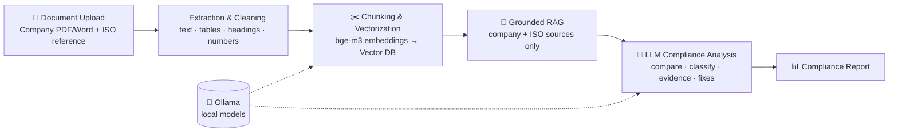

<div align="center">

# 🛡️ SLM Powered Regulatory

### A 100% local, privacy-first RAG system for ISO/IEC 27001 compliance analysis

Upload your organization's policies. Get a grounded, evidence-backed compliance report — without a single byte leaving your machine.


[Quick Start](#-quick-start) · [How It Works](#-how-it-works) · [Architecture](#-architecture) · [Configuration](#-configuration) · [Roadmap](#-roadmap)

</div>

---

## 📖 Overview

**SLM Powered Regulatory** reads an organization's PDF and Word documents, compares them against ISO 27001 requirements, and produces a structured **compliance report** containing the verdict for each requirement, the supporting **evidence** quoted from the company's own files, and **recommended fixes** for every gap.

It is built around three principles:

| Principle | What it means |
|---|---|
| 🔒 **Fully local** | Embeddings and generation run through [Ollama](https://ollama.com). No cloud APIs, no data leaves your machine. |
| 📎 **Grounded answers** | The model answers only from the retrieved company and ISO sources. Unsupported claims are blocked, and every finding is traceable to a source passage. |
| 🧩 **Single source of truth** | All logic lives in one module (`regulatory_core.py`), shared by the dashboard and the notebook, so results are consistent everywhere. |

---

## ✨ Features

- **Custom web dashboard** built with pure HTML, CSS, and JavaScript, served locally by a lightweight Python server, with drag-and-drop uploads and no command-line work after setup.
- **Advanced PDF/Word extraction** that preserves text, tables, headings, numbers, and the relationships between them.
- **Intelligent chunking and vectorization** with multilingual embeddings (`bge-m3`) stored in a vector database.
- **Grounded RAG retrieval** restricted to the company's files and the ISO reference only.
- **Compliance analysis** that understands each requirement, compares it with the evidence, classifies the level of compliance, and recommends fixes.
- **Editable requirements catalogue** (`iso27001_requirements.json`) that you can extend without touching code.
- **Step-by-step notebook** for experimentation, auto-generated from the core module so it never drifts out of sync.
- **Swappable models**: use `qwen2.5:14b` for quality or `qwen2.5:7b` on a weaker machine.

---

## 🏗️ Architecture



---

## ⚙️ How It Works

| # | Stage | Description |
|---|---|---|
| 1 | **Document Upload** | Upload the company's PDF/Word files, and optionally a licensed ISO reference copy. |
| 2 | **Extraction & Cleaning** | Pull out text, tables, headings, and numbers while preserving their order and relationships. |
| 3 | **Chunking & Vectorization** | Split the text into semantically meaningful chunks, embed them with `bge-m3`, and store them in the vector database. |
| 4 | **Grounded RAG** | For each requirement, retrieve relevant passages from the company files and ISO sources only. Answers without source support are rejected. |
| 5 | **Compliance Analysis** | The LLM interprets the requirement, compares it with the retrieved evidence, classifies the level of compliance, extracts the evidence, and suggests remediation. |
| 6 | **Local Execution** | Every model call goes through Ollama on your own hardware. |
| 7 | **Evaluation** | Measure accuracy, retrieval quality, numeric correctness, and citation validity, and track hallucinations. |

---

## 🚀 Quick Start

### Prerequisites

- Python 3.10 or newer
- [Ollama](https://ollama.com/download) installed and running
- Enough RAM/VRAM for your chosen model (see [Configuration](#-configuration))

### 1. Pull the local models

```bash
ollama pull qwen2.5:14b      # use qwen2.5:7b on a weaker machine
ollama pull bge-m3           # multilingual embeddings
```

### 2. Install dependencies

```bash
pip install -r requirements.txt
```

### 3. Generate a sample document (optional)

```bash
python make_sample.py
```

### 4. Launch the dashboard

```bash
python server.py
```

On Windows you can also just double-click **`run.bat`**. Then open the local address shown in the terminal, drag and drop your documents into the page, and run the analysis.

### Prefer notebooks?

```bash
jupyter notebook SLM_Powered_Regulatory.ipynb
```

---

## 🗂️ Project Structure

```text
.
├── regulatory_core.py            # All logic: extraction, chunking, retrieval, analysis
├── server.py                     # Local Python server: serves the UI and exposes the API
├── index.html                    # Dashboard markup
├── style.css                     # Dashboard styling
├── app.js                        # Dashboard behavior (uploads, requests, rendering results)
├── run.bat                       # One-click launcher for Windows
├── iso27001_requirements.json    # ISO 27001 requirements as short paraphrases (editable)
├── build_notebook.py             # Generates the notebook from regulatory_core.py
├── make_sample.py                # Creates a sample company document
├── SLM_Powered_Regulatory.ipynb  # Step-by-step notebook (generated)
└── requirements.txt              # Python dependencies
```

| File | Purpose |
|---|---|
| `regulatory_core.py` | Single source of truth for all logic |
| `server.py` | Local server that serves the dashboard and connects it to the core logic |
| `index.html` · `style.css` · `app.js` | Web dashboard (HTML, CSS, JavaScript) |
| `run.bat` | One-click launcher on Windows |
| `iso27001_requirements.json` | Requirements catalogue, editable and extendable |
| `build_notebook.py` | Rebuilds the notebook. Run `python build_notebook.py` after any edit to the core |
| `make_sample.py` | Produces a sample company document for testing |

---

## 🔧 Configuration

| Setting | Where | Default | Notes |
|---|---|---|---|
| `LLM_MODEL` | `regulatory_core.py` | `qwen2.5:14b` | Switch to `qwen2.5:7b` on lower-spec machines |
| Embedding model | `regulatory_core.py` | `bge-m3` | Multilingual, so documents in different languages work |
| Requirements | `iso27001_requirements.json` | Paraphrased summaries | Add or edit entries to extend coverage |

> After changing `regulatory_core.py`, regenerate the notebook with `python build_notebook.py`.

---

## 🧪 Evaluation

Quality is measured along four axes:

- **Retrieval quality**: does the system fetch the right passages for each requirement?
- **Classification accuracy**: do verdicts match human judgement?
- **Numeric correctness**: are figures, dates, and thresholds quoted accurately?
- **Citation validity and hallucination rate**: does every claim trace back to a real source passage?

A formal benchmark against 30–50 human-labelled requirements is planned (see the roadmap).

---

## ⚠️ Important Notes

- **ISO copyright.** The JSON file contains short, paraphrased summaries, not the official standard text. If you hold a licensed copy of ISO/IEC 27001, upload it from the dashboard to ask questions against it.
- **Scanned PDFs.** Image-only PDFs need OCR first:
  ```bash
  ocrmypdf input.pdf output.pdf
  ```
- **Decision support, not certification.** The report helps you find and fix gaps. It does not replace a qualified auditor or an official certification process.

---

## 🗺️ Roadmap

- [ ] Reranker (`bge-reranker`) to improve retrieval precision
- [ ] Full coverage of the remaining Annex A controls (93 in total)
- [ ] Accuracy evaluation on 30–50 human-labelled requirements
- [ ] LoRA fine-tuning of the local model
- [ ] Built-in OCR for scanned documents

---

## 🤝 Contributing

Contributions are welcome. Open an issue to discuss a change, or submit a pull request. If you edit `regulatory_core.py`, run `python build_notebook.py` before committing so the notebook stays in sync.

---

<div align="center">

**Built for teams who need compliance answers they can trust, and keep private.**

</div>
